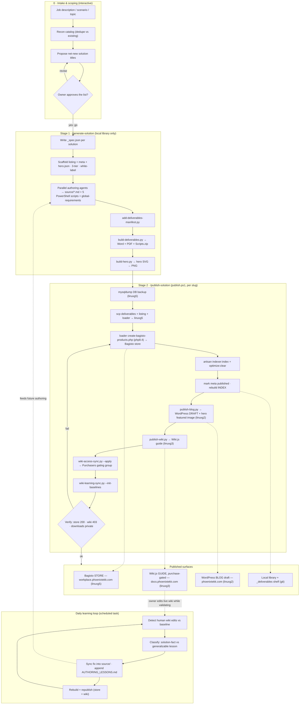

# Workplace Solutions — Solution-Doc Factory Workflow

The factory turns a job description / topic into a productized IT solution published across
three customer-facing surfaces, and learns from human wiki edits over time.

> **Where products publish:** the Bagisto store at **workplace.phoenixtekk.com** (linuxg5,
> `/home/workplace`) — **not** `crm.phoenixtekk.com`, which is a separate Dolibarr ERP/CRM on the
> same host.

## Stage summary

| Phase | Command / tool | Output |
|---|---|---|
| 0 Intake | interactive | Approved, deduped list of net-new solution titles |
| 1 Generate | `/generate-solution` (specs → scaffold → parallel agents → build-deliverables → build-hero) | Word/PDF/Scripts.zip + hero PNG in the local library |
| 2 Publish | `/publish-solution` → `publish.ps1` | Live store listing, gated wiki guide, blog draft |
| Loop | `wiki-learning-sync.py` (daily scheduled task) | Human corrections synced back into source + authoring lessons |

## Source files (repo)

- `docs/factory-workflow.mmd` — Mermaid source
- `docs/factory-workflow.drawio` — draw.io / diagrams.net (exports to Visio `.vsdx`)
- `docs/factory-workflow.md` — this document
